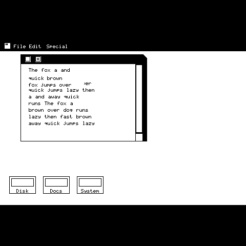

<div align="center">



# MosaiMac

**QuickDraw for ESP32-S31**

The 1-bit graphics core of the 1984 Macintosh -- BitBlt, Region, GrafPort -- rewritten as portable C11 for the 480x480 CO5300 on ESP-Mosaico.

[](https://www.espressif.com/en/products/socs/esp32-s31)
[](test)
[](LICENSE)

[Project page](https://hkgood.github.io/MosaiMac/) · [Design notes](docs/DESIGN.md) · [中文](README.md)

</div>

---

## Build

**Host** -- no hardware needed

```sh
make test     # 1509 + 1615 checks
make bench    # throughput
make asan     # ASan + UBSan
make render   # regenerate the still
make replay   # regenerate the drag animation above
```

**ESP32-S31**

```sh
cd platform/esp32s31
. $IDF_PATH/export.sh
idf.py set-target esp32s31
idf.py build flash monitor
```

Or go through the [esp-mosaico-vibe](https://github.com/esp-mosaico/esp-mosaico-vibe) workspace -- the sibling project [mosaico-film](https://github.com/hkgood/mosaico-film) does exactly that, and it gets you the `mosaico.py project sim` PC simulator for free.

Board bring-up uses `bsp_display_new()` / `bsp_touch_new()` from [esp-mosaico-bsp](https://github.com/esp-mosaico/esp-mosaico-bsp).

## Status

| | |
|---|---|
| ROP / CopyBits / Region / GrafPort / dirty-rect loop | done -- 3,124 host checks, ASan + UBSan clean |
| ESP-IDF platform layer (CO5300 + CST9220 + push) | compiles |
| `.irisfw` bundle | **produced**, 237.7 KB |
| Installed and verified on hardware | no -- there is no board here |

Built in the [esp-mosaico-vibe](https://github.com/esp-mosaico/esp-mosaico-vibe) workspace with `mosaico.py iris system-update`:

```
qd_esp32s31-system-update.irisfw    237.7 KB
  manifest.json         esp-iris-system-update/0.2
  partition-table.bin   4 KB
  ota_0.bin             466 KB
```

ESP-IDF **v6.2.0** (master @ `7b9cc1ac`, the commit the workspace pins), target `esp32s31`, 16 MB flash.

**Nothing has been installed or run.** CO5300 init timing, CST9220 coordinate calibration and the even-aligned window behaviour on a real panel are all unverified.

The animation is not a screen recording. `make replay` drives a real drag
through the engine and dumps every one of the 73 frames; each is the output of
the same `src/*.c` that runs on the S31.

## Three decisions

**480x320 internally, no rescale.** 480/320 = 1.5 and 512/342 = 1.497, so the aspect ratios already agree and a whole resampling stage disappears.

**Regions as span lists.** The original crammed a Region into 16 bytes of packed RLE. The S31 has 16 MB of PSRAM, so memory is cheap and verifiability is not. Rect regions still cost zero heap.

**Damage is a region, not a rectangle.** The bounding box of a window move is the whole window -- 40,800 px / 82 KB even for a one-pixel move. As a region, split into runs, it is 818 px / 1.6 KB. On the same hardware that is the difference between 46 fps and a frame rate you can drag at.

Measurements, benchmark data and the bugs the engine had are all in [docs/DESIGN.md](docs/DESIGN.md).

## Layout

```text
include/qd/qd.h      public API
src/                 the engine (portable C11)
test/                host tests
bench/               throughput measurements
tools/               renderer, font, PPM->PNG, API-based push
platform/esp32s31/   ESP-IDF project
docs/                design notes + GitHub Pages
```

---

[Apache-2.0](LICENSE) · 2026 · Apple, Macintosh and QuickDraw are trademarks of Apple Inc.; this project is not affiliated. QuickDraw is reimplemented from observed behaviour; no Apple source is used.
