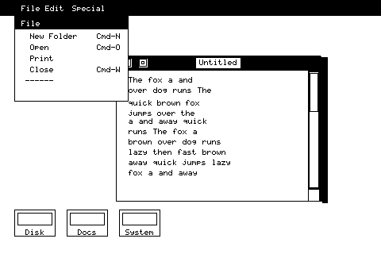

<div align="center">



# MosaiMac

**QuickDraw for ESP32-S31**

The 1984 1-bit graphics system, on a 480x480 AMOLED.

[](https://hkgood.github.io/MosaiMac/)
[](https://www.espressif.com/en/products/socs/esp32-s31)
[](https://www.espressif.com)
[](include/qd/qd.h)
[](test)
[](LICENSE)

**English** · [中文](README.md)

</div>

---

<p align="center">
  
</p>

That image is **not a mock-up**. The renderer in this repository draws it through exactly the same `src/*.c` ROP, Region and GrafPort code that runs on the ESP32-S31. If the span XOR were wrong the screenshot would show ghosting; as it happens, it is visual evidence that the engine is correct.

| | |
| :-: | :-: |
| **1 bit/pixel**, 18.75 KB framebuffer | **480x320** logical screen, centred in a 480x480 panel |
| **Region clipping**, span lists | **Dirty rects** accumulated as regions, not rectangles |

---

## Why this is more than "drawing pixels on a microcontroller"

The 1984 Macintosh ran a complete windowing system on a 68000 at 7.836 MHz with **128 KB of total RAM**: draggable windows, region clipping, dirty-rectangle redraw, scroll bars, pull-down menus. Its core was BitBlt and Region, and those are still the right answer for a classic-Mac-style interface on a 480x480 panel -- because **1-bit is the only depth at which you can afford a full-screen repaint inside 16 ms on a device with no GPU, no DMA engine and no alpha**.

MosaiMac reimplements that core.

## Three decisions

**480x320 internally, no 512x342 rescale.**
The original screen was 512x342. This panel is 480x480. `480/320 = 1.5` and `512/342 = 1.497`, so the aspect ratios already agree. Going native removes the resampling stage entirely. The cost is a 60-byte stride, which leaves every row 16-byte misaligned; that trade is worth it.

**Regions as span lists, not the 1984 packed-RLE format.**
The original crammed a Region into the 16 bytes its `Region` record allowed, so every set operation was hand-rolled bit twiddling. The S31 has 16 MB of PSRAM, so spending memory on verifiability is free. Rectangular regions live in place with zero heap traffic, and `qd_region_is_rect()` lets the ROP skip the per-scanline walk entirely.

**Damage is a region, not a rectangle.**
The important one, covered below.

## Dirty rectangles: 1 pixel of drag vs 40,800

A window move damages the symmetric difference of the old and new positions. **Store that as a rectangle** (its bounding box) and even a one-pixel move produces a bounding box equal to the **whole window** -- 40,800 px, 82 KB per frame. At 14-28 MB/s over QSPI that is 46 fps.

**Store it as a region and split it into per-scanline runs**, and a one-pixel move pushes **818 px, 1.6 KB**:

| move | pushed |
|---|---|
| 40 px diagonal | 25,600 px (51 KB) |
| 1 px diagonal | **818 px (1.6 KB)** |
| no-op | 0 px |

`qd_bsp_flush()` coalesces vertically identical runs into maximal rectangles, so a window move's damage collapses to roughly four rectangles instead of two per edge per scanline. On identical hardware, that is the entire difference between 46 fps and a frame rate you can actually drag at.

`test/test_window.c` verifies the whole loop with no hardware: it drags a window and, after every step, asserts that no pixel outside the window is still set (that would be missed damage), that the title bar and border really were drawn, and that the static window underneath survives being crossed.

## Measured

Host: x86-64, GCC 12, `-O2`. The S31 is slower -- **the ratios are the signal, the absolute numbers are not.**

```
CopyBits, full screen 480x320
  srcXor   aligned        0.007 ms      22,000 Mpixel/s
  srcXor   misaligned     0.047 ms       3,270 Mpixel/s
  srcXor   L-region clip  0.014 ms      10,600 Mpixel/s
  200x150 window move     0.011 ms      90,600 ops/s

1bpp -> RGB565
  full frame              0.150 ms       1,030 Mpixel/s
  120x90 dirty rect       0.011 ms

Panel cost (modelled, not measured)
  @ 40 MHz QSPI: full frame 21.9 ms (46 fps) | 120x90 dirty 1.54 ms (648 fps)
  @ 80 MHz QSPI: full frame 11.0 ms (91 fps) | 120x90 dirty 0.77 ms (1296 fps)
```

**1bpp packs 8 pixels per byte**, which is why a full-screen XOR is 18.75 KB and takes single-digit microseconds.

Two optimisations were forced by these numbers rather than designed in advance:

- **Unaligned BitBlt was 14x slower than aligned** on the per-byte chunked path. Dragging a window is misaligned by definition and is the most common BitBlt a Macintosh-style UI performs, so that was not acceptable. Sliding the source through a 64-bit window took it from 0.104 to **0.047 ms**.
- **`qd_region_spans()` was O(y)** per scanline, because it summed the per-line span counts up to the requested line, which made a full-screen region-clipped blit quadratic. A prefix-sum offset table took it from 0.040 to **0.014 ms**.

## Bugs the engine had

All recorded in the code comments, because every one of them is invisible on the common path:

- **`rop_byte_chunk()` was missing a shift by the destination's bit phase.** Correct only when `dp == 0`, i.e. **every unaligned span was wrong**. The whole-byte path hid it.
- **`qd_fill_span_1bpp()`'s partial-byte mask ignored the bit phase.** Only wrong when the head or tail got clipped, which first surfaced when `frameRect` clipped a 3 px border down to 3 px.
- **XOR results were truncated to the intersection of the operands' bounds.** Only INTERSECT is bounded by the overlap; XOR and UNION both reach outside it.
- **`spans_xor` lost spans.** Neither a head/tail merge nor a two-cursor merge is correct when one span overlaps the *next* span of the other list. Replaced with an event sweep over the union of both boundary sets.
- **`qd_port_set_white()` existed and `qd_fill_rect()` ignored it entirely.** The caller sets a white pen expecting to erase, gets black, and has no way to notice.
- **The empty region was a sentinel pointer** `(int32_t*)1`, so a missing initialisation turned into heap corruption rather than an empty region.

The guards are all still here: a 16x16 phase-combination sweep, an exhaustive 16,512-span fill sweep against a reference model, and a dedicated pen test. ASan and UBSan are clean.

## Layout

```text
include/qd/qd.h      the whole public API
src/                 the engine: ROP / Region / GrafPort (portable C11)
test/                host correctness tests, 1509 + 1615 checks
bench/               host throughput measurements
tools/               renderer, font, PPM->PNG, API-based push
platform/esp32s31/   ESP-IDF project: CO5300 + CST9217 + push path
docs/                GitHub Pages and images
```

The core is portable C11 with no platform dependencies: built and tested on a host, cross-compiled for the S31, same `src/*.c` either way.

### Bitmap conventions

- 1 bit per pixel, **MSB-first**; the leftmost pixel of a row is bit 7.
- `rowBytes` is the **stride and includes the per-row slack**. This is the easiest thing to get wrong: the engine uses it to find the next row, so it has to include the slack, while `QD_SCREEN_ROWBYTES` (60) is the payload width that bit arithmetic is based on. Setting `rowBytes` to the payload width while allocating stride bytes silently shears the image, because the writer and any reader then disagree about where row N+1 starts.
- Every row needs `QD_ROW_SLACK` (8) readable bytes of slack. Costs 8 B x height.

## Build

**Host (tests and benchmarks, no hardware)**

```sh
make test     # 1509 + 1615 checks
make bench    # throughput
make asan     # ASan + UBSan
make render   # regenerate docs/assets/img/workspace.png
```

**ESP32-S31**

The [esp-mosaico-vibe](https://github.com/esp-mosaico/esp-mosaico-vibe) workspace is the recommended route; the sibling project [mosaico-film](https://github.com/hkgood/mosaico-film) does exactly this, and it gets you the workspace's pinned IDF version and the `mosaico.py project sim` PC simulator for free:

```sh
git clone https://github.com/esp-mosaico/esp-mosaico-vibe.git
cd esp-mosaico-vibe
git submodule update --init \
  submodule/esp-mosaico-utils submodule/esp-mosaico-bsp
git clone https://github.com/hkgood/MosaiMac.git projects/qd_esp32s31
```

Or as a standalone ESP-IDF project:

```sh
cd platform/esp32s31
. $IDF_PATH/export.sh
idf.py set-target esp32s31
idf.py build flash monitor
```

Board bring-up is delegated to [esp-mosaico-bsp](https://github.com/esp-mosaico/esp-mosaico-bsp) (`bsp_display_new()` / `bsp_touch_new()`) rather than hard-coding the CO5300 and CST9217 pin mapping here.

## Status

| Part | State |
|---|---|
| ROP / CopyBits / fill / frameRect | done, host-tested |
| Regions: union / intersect / xor / offset / invert | done, host-tested |
| GrafPort: clip, origin, Save/RestoreGState, rect + region clip | done, host-tested |
| Window-move dirty-rect loop | done, host-tested |
| 1bpp -> RGB565 expansion, banded push | done, host-tested |
| ESP-IDF / ESP32-S31 port | **written, never compiled** |

The core passes **3,124 checks** on a host under ASan and UBSan. The platform layer is a reviewed skeleton -- there was no ESP-IDF toolchain available to compile it. **"It compiles" is the first open question, not "it works".**

## Alternatives considered

**Linux on the S31.** Wrong for a first product. The S31 has no MIPI DSI, so a QSPI panel needs a hand-written Linux SPI panel driver, and Espressif's own Linux BSP targets the headless Function-CoreBoard. The output would be an fbdev console, which is less useful than a real 1-bit window system.

**`systemless`.** An active Rust runtime for classic Macintosh software, and the closest prior art I found. GPL-3.0-or-later, and its Cranelift JIT work is predominantly x86-64, so it is not a direct path to the S31. The compatibility layer is worth studying; the graphics engine is not worth copying.

**Apple's actual QuickDraw source.** Not used, and the reason this repository defaults to private until that boundary is settled. The *interface* is reimplemented; no code is copied.

---

[Apache License 2.0](LICENSE) · 2026

Apple, Macintosh and QuickDraw are trademarks of Apple Inc. This project is independent and is not affiliated with or endorsed by Apple.
